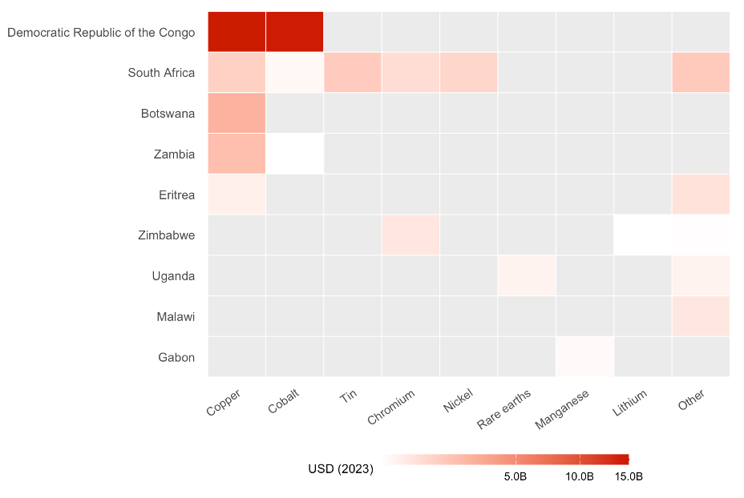
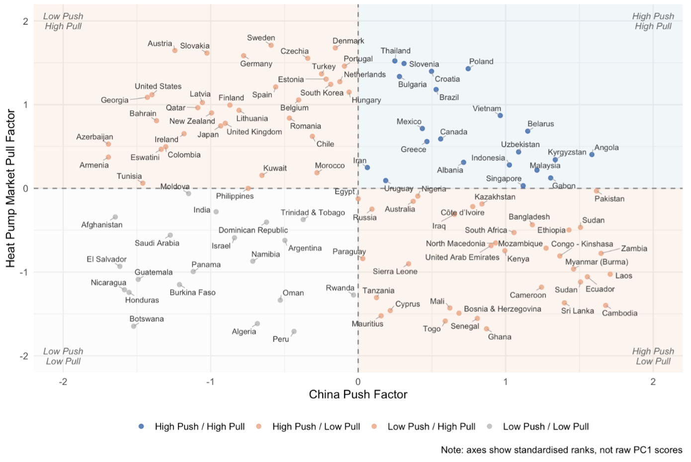

I examine how great power competition over global energy transition, waged through development finance, industrial policy, foreign policy, technology transfer, clean energy technology manufacturing, and international trade, shapes development outcomes, resource management, and global environmental governance.

## Working papers

::: {.paper}
{.paper-thumb fig-alt="Map of nighttime light changes in Zambia"}
[Is There a Development Quid Pro Quo? Chinese Finance and Critical Mineral Access in Africa]{.paper-title}\
[Revise and resubmit]{.paper-meta}

The impact of China’s engagement in Africa has drawn much attention in scholarly debates. Some critics view China’s interest in Africa as a form of neocolonialism, arguing that China is extracting natural resources for its own state interests. China has been involved in numerous mining activities across the continent, gaining access to critical minerals such as cobalt and copper, which are strategically important for national energy security. At the same time, China has also financed many development projects to help African countries address pressing development challenges. Using multiple datasets on development finance and mining properties, this paper examines whether Chinese development finance coincides with its mine acquisitions in 53 African countries, and if so, which minerals are associated with which type of Chinese finance. The results show that minerals needed for clean energy technologies such as copper, cobalt, nickel, and platinum group metals are significantly associated with Chinese loan commitments to recipient countries, while uranium is the mineral most strongly linked to development projects, particularly those including a substantial grant component and highly concessional repayment terms. This paper carries significant policy implications for global energy transitions, critical mineral supply chains, and development finance by revealing how various financial instruments are associated with critical minerals and by highlighting the need for more transparent development practices.

[[Working paper](files/Dai_Quid_Pro_Quo_WP.pdf)]{.paper-links} 
:::

::: {.paper}
{.paper-thumb fig-alt="Chinese-financed-solar-farm-in-zambia"}
[Why Energy Infrastructure Investment Delivers Delayed Electricity Access]{.paper-title}\
[with J. Guan and P. Jagger · Under review]{.paper-meta}

Nearly 600 million people in sub-Saharan Africa lack access to electricity, even as foreign-financed generation and transmission capacity has expanded rapidly. Whether that investment reaches households, and how quickly, is rarely measured, because energy projects are typically evaluated by whether they were built and how much capacity they added, not by whether nearby communities gained access. Zambia, a major recipient of Chinese energy finance and the first African country to default on its external debt during the COVID-19 pandemic, offers a rare test. We link a staggered portfolio of Chinese-financed power plants and transmission lines completed between 2014 and 2019 to the national utility’s geocoded grid maps and to satellite-derived, settlement-level electricity access data, forming a pixel-level panel for 2013–2020. We find that, in rural areas where baseline access is lowest, access gains appear only around six years after completion, while urban centers, where the access index is already at its ceiling, show no measurable change. Estimates by asset type suggest that areas near new transmission lines respond earlier than areas served by new generation. These divergent timelines are consistent with a coordination failure in which new generation capacity remains unused until distribution networks and household connections catch up, whereas transmission projects link communities to generation that already exists. Our findings suggest that financing for new generation should be paired with investment in distribution networks and connection programs, with explicit access targets written into financing agreements, if new capacity is to reach communities quickly.
:::

::: {.paper}
{.paper-thumb fig-alt="Push-Pull-framework"}
[Industrial Electrification in the Global South: China's Potential Role]{.paper-title}\
[with C. Springer]{.paper-meta}

Industrial electrification is central to decarbonizing industry in the Global South, where industrial output and emissions are expected to grow rapidly. China, the world's largest manufacturer of clean energy technologies and a major source of development finance, is well positioned to support this transition, yet its potential role remains poorly understood. This paper assesses that role through industrial heat pumps, a near-commercial technology that can replace fossil fuel boilers for low- and medium-temperature process heat. We first map China's industrial heat pump manufacturing through a structured review of English- and Chinese-language sources, corroborated by expert interviews, and analyze Chinese heat pump exports using UN Comtrade data for 2018-2023. We then develop a push-pull framework, using principal component analysis to combine indicators of Chinese trade, development finance, and power-sector presence (push) with indicators of each country's readiness to adopt industrial heat pumps (pull). We find that China's industrial heat pump sector is held back by limited demand and deployment experience, not technical capacity alone, and that its heat pump exports flow mainly to high-income OECD markets. Push exposure is concentrated in Southeast Asia and parts of Africa, while pull potential closely tracks each country's stage of industrial and energy development. Vietnam and Brazil emerge as the most promising partners, combining deep Chinese engagement with favorable domestic conditions. These results suggest that China can act as a scaled provider of equipment and finance in more industrialized markets, while in less developed ones its contribution lies in building the grid and industrial foundations that electrification requires.
:::

## Select Publications

::: {.paper}
[Unlocking Financial Inclusion through Solar Technology Adoption in Malawi]{.paper-title}\
[with R. McCord, K. Beach, A. Mahieu, T. Chilongo, C. Jumbe, and P. Jagger · *Energy Economics* 154 (2026): 109138]{.paper-meta}

[[Article](https://doi.org/10.1016/j.eneco.2026.109138)]{.paper-links} 
:::

::: {.paper}
[The digital economy and rural energy consumption in China]{.paper-title}\
[with H. Mao, X. Zhou and Y. Fu · *Energy Policy* 210 (2026): 115063]{.paper-meta}

[[Article](https://doi.org/10.1016/j.enpol.2025.115063)]{.paper-links}
:::

::: {.paper}
[Can off-grid household solar provide sustainable energy for all? Adoption and sustained use of solar technologies in Malawi]{.paper-title}\
[with A. Mahieu, R. McCord, K. Beach, T. Chilongo, C. Jumbe, and P. Jagger · *Energy Research & Social Science* 127 (2025): 104249]{.paper-meta}

[[Article](https://doi.org/10.1016/j.erss.2025.104249)]{.paper-links}
:::

::: {.paper}
[The role of new agricultural business entities in guiding smallholder farmers' green production: Evidence from chemical fertilizer reduction in China]{.paper-title}\
[with Y. Lu, Q. Liu and H. Mao · *Environmental Impact Assessment Review* 114 (2025): 107963]{.paper-meta}

[[Article](https://doi.org/10.1016/j.eiar.2025.107963)]{.paper-links}
:::

## Work in progress

::: {.paper}
[China's Strategic Shift in Clean Energy Technology Development amid Growing Global Protectionism]{.paper-title}\
[with J. Lewis]{.paper-meta}
:::

::: {.paper}
[Pledges to Power, African Negotiation strategies and the Delivery of FOCAC Energy Commitments]{.paper-title}\
[with N. Adjekai Adjei]{.paper-meta}
:::

